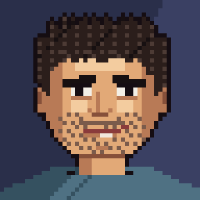
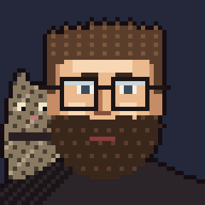
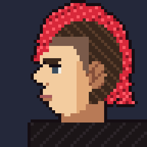
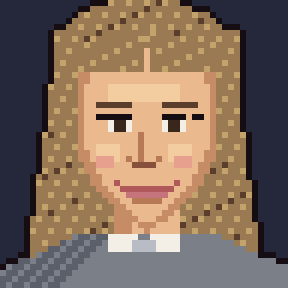

# Character portraits

Static portraits (`*_48.png` = real size, `*_384.png` = enlarged) and animated previews:

| Game name | Portrait file | Animation |
|---|---|---|
| Duke | `gyl_*.png` |  |
| Skip | `dealone_*.png` |  |
| Walt | `ding_*.png` |  |
| Wes | `jimbo_*.png` |  |
| Norm | `tilah_*.png` |  |
| Kelsey | `helga_*.png` |  |

The game does not use these files: the portraits and their animation (look left / right / up, blink, talk, wince when hurt) are drawn live in code (`src/characters.js`).
The GIFs are just previews of what that animation looks like.
